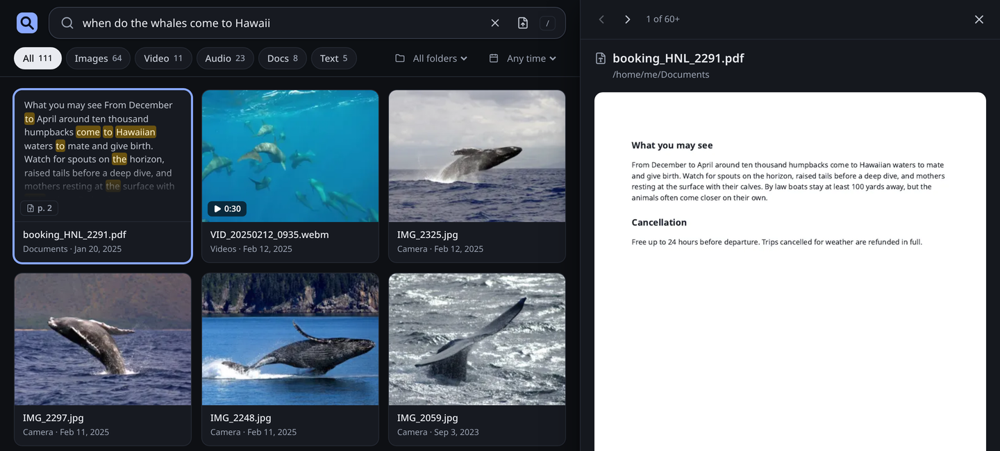
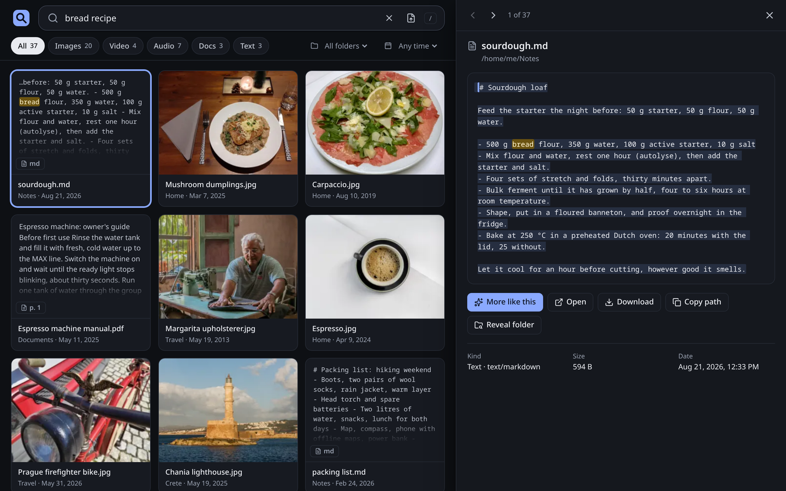
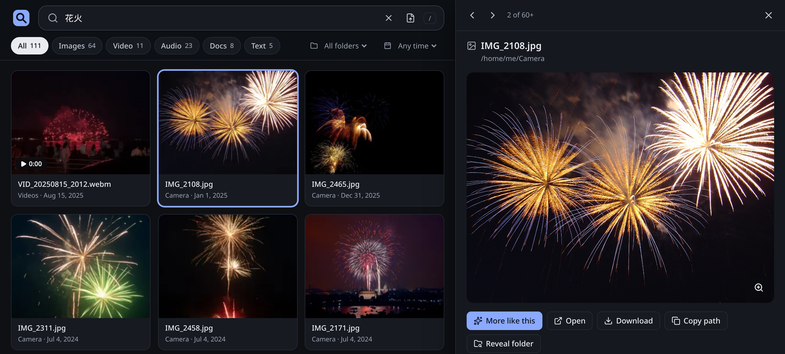

<p align="center">
  
</p>

<h1 align="center">rummage</h1>

<p align="center">
  <b>Search your photos, videos, recordings and documents by what is in them.</b><br>
  Runs on your machine: one binary, on your GPU (Vulkan, ROCm, CUDA) or the CPU.
</p>

<p align="center">
  <a href="https://github.com/av/rummage/releases"></a>
  <a href="https://github.com/av/rummage/actions/workflows/ci.yml"></a>
  <a href="LICENSE"></a>
</p>

<p align="center">
  
</p>

<p align="center"><sub>One query, <b>“birds singing”</b>, over files named like <code>REC_0451.ogg</code> and <code>IMG_2339.jpg</code>.<br>
rummage <i>listened</i> to the recordings, <i>watched</i> the video and <i>read</i> the PDF.</sub></p>

## What grep and Spotlight can’t find

File names say `IMG_2248.jpg`. rummage searches what is inside: the picture, the sound, the page.

**“humpback whale jumping out of the water”**: breaching humpbacks first, then the rest of the whales. No file name says “whale”.


**“a storm at night”**: opens a clip at 0:30, where a sunny beach has given way to lightning.


**“when do the whales come to Hawaii”**: page 2 of a boat booking PDF. “From December to April…”



**“how do I bake a loaf of bread”**: the method in a notes file, then the loaves you photographed.



**“花火”**: Japanese for fireworks. Nothing in the library is in Japanese.



## Try it

Linux x86_64. This is the Vulkan build: recent AMD, NVIDIA and Intel GPUs, with a CPU fallback.
ROCm, CUDA and CPU builds, Docker images and building from source: [Install](docs/install.md).

```sh
curl -LO https://github.com/av/rummage/releases/download/v0.1.1/rummage-0.1.1-linux-x86_64-vulkan.tar.gz
tar xzf rummage-0.1.1-linux-x86_64-vulkan.tar.gz
cd rummage-0.1.1-linux-x86_64-vulkan
./rummage folders add ~/Pictures
./rummage serve
```

Open <http://127.0.0.1:8099/> and describe what you are looking for. The first run downloads the
model (about 860 MB); results fill in while it indexes. From another terminal:

```sh
./rummage search "birds singing"
./rummage doctor        # GPU, model files, ffmpeg, poppler, config
```

On an AMD Radeon 8060S the demo library above (111 files) indexes in under two minutes, and a
search answers in about 10 ms ([benchmarks](docs/BENCH-fedora.md)).

## Also

- **Search by example.** Drop a photo, a sound or a note on the page to find what is like it.
- **Other languages.** “花火” finds the fireworks; “Nordlichter” finds the northern lights.
  The model is Google DeepMind’s multilingual [EmbeddingGemma 2](https://huggingface.co/google/embeddinggemma-2).
- **Private.** Files and queries never leave your machine. No account, no cloud.
- **Keeps up.** New, changed, moved and deleted files are picked up as they happen.
- **Scriptable.** Everything the page does goes through an HTTP API, and there is a CLI.

## Docs

- [Install](docs/install.md): release builds, Docker, from source
- [Using rummage](docs/usage.md): the web page, the CLI, running behind a proxy
- [Configuration](docs/configuration.md) · [HTTP API](docs/api.md)
- [How it works](docs/how-it-works.md): supported files, indexing, search
- [Development](docs/development.md)
- [Screenshots and demo library](docs/screenshots/README.md): every query and file shown here
  (public-domain and CC0 media from Wikimedia Commons, plus a few documents written for the demo)

## Licence

[Apache License 2.0](LICENSE); see [NOTICE](NOTICE). rummage builds in llama.cpp and ggml (MIT);
[docs/LICENSES-THIRD-PARTY.md](docs/LICENSES-THIRD-PARTY.md) lists every component and its licence.
