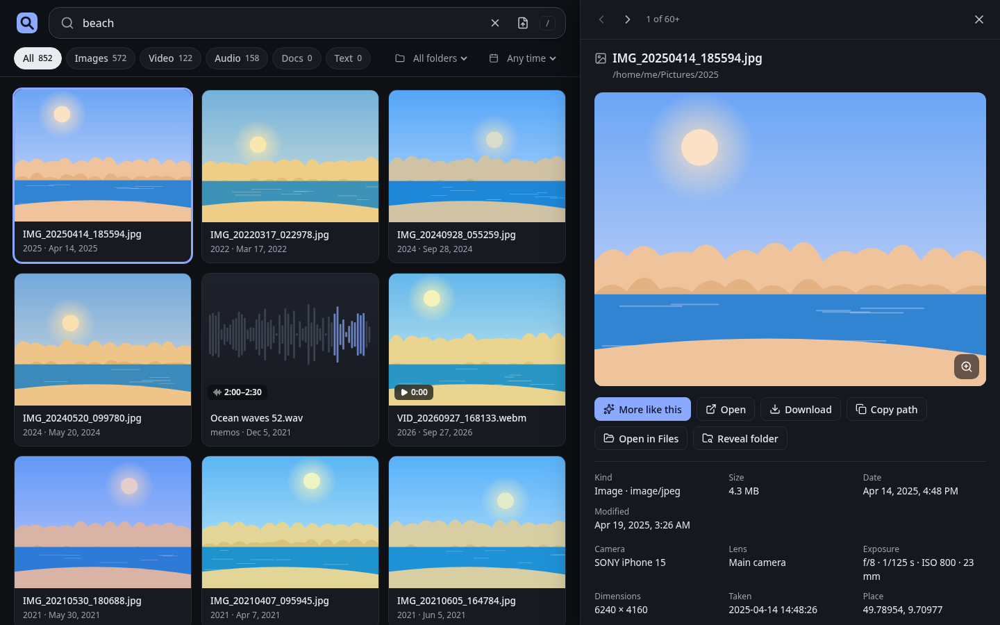
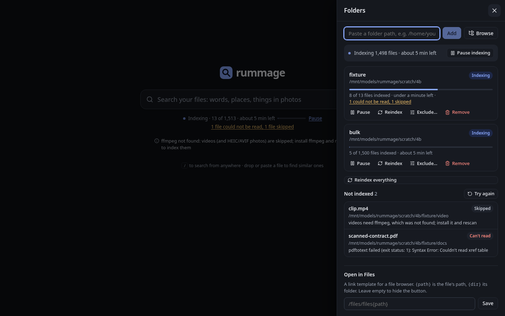

# rummage

Local multimodal semantic search for your files. One binary serves a web UI and an HTTP API,
watches the folders you choose, and indexes text, images, documents, audio and video with
Google DeepMind's [EmbeddingGemma 2](https://huggingface.co/google/embeddinggemma-2), running
on llama.cpp with CUDA, ROCm, Vulkan or CPU.

The program, config, CLI, API, web UI, indexer and embedding engine are in place. The model
files download into `model.dir` the first time something is embedded.

## Quickstart

```sh
cargo build --release                 # CPU build; GPU builds: --features vulkan|rocm|cuda
./target/release/rummage folders add ~/Pictures
./target/release/rummage serve        # http://127.0.0.1:8099/
./target/release/rummage search "red bicycle by a lake"
./target/release/rummage doctor       # checks config, index, folders, GPU and ffmpeg
```

Behind a proxy under a sub-path (e.g. nginx `location /search/ { proxy_pass http://127.0.0.1:8099/; }`):

```sh
rummage serve --bind 0.0.0.0:8099 --base-path /search
```

rummage accepts requests with or without the prefix, and honours `X-Forwarded-Prefix` when the
proxy strips it, so links in responses and the UI always carry the right prefix.

The CLI talks to a running server when it finds one (at `server.bind`, or `--server URL`) and
opens the index directly otherwise (`--local` forces that).

## The web page

`rummage serve` serves a search page at `/` (or under `--base-path`). Type to search; results
come as you type, and a click (or Enter) opens a preview beside them: photos with zoom and EXIF,
video and audio from the matching moment, PDFs at the matching page, text at the matching passage.

- `/` jumps to the search box from anywhere; Enter opens the top result.
- Arrow keys move through results; in the preview, Left/Right go to the previous/next result and
  Esc closes it.
- Drop or paste an image, audio or text file anywhere to search by it; "More like this" does the
  same for any result.
- The URL holds the search (`?q=&type=&folder=&date=&in=&like=&item=`), so links and Back/Forward
  work, and other pages can link straight to results or to an open item.
- The folder icon opens the folders drawer: add folders (paste a path or browse the server),
  exclude, reindex, pause or resume all indexing, see each folder's progress and time left live,
  and see which files could not be read and why (with a "Try again"). On first run it opens by
  itself. Notes from the server (e.g. ffmpeg missing, the model still loading) show under the
  search box.





More in [docs/screenshots](docs/screenshots).

## Install

Each [release](https://github.com/av/rummage/releases) has one Linux x86_64 build per backend,
`rummage-<version>-linux-x86_64-<backend>.tar.gz` (the binary, this README and the licences), with
SHA-256 sums. Pick the one for your GPU; every GPU build also runs on the CPU, with a warning,
when it finds no GPU.

| Backend | For | Needs on the system |
|---|---|---|
| `vulkan` | any recent GPU: AMD, NVIDIA, Intel. The fastest build on AMD's Radeon 8060S | the Vulkan loader (`libvulkan.so.1`) and a Vulkan driver (Mesa RADV/ANV, or NVIDIA's) |
| `rocm` | AMD GPUs: gfx1151/1150 (Strix Halo/Point), gfx1100-1102 (RX 7000), gfx1200/1201 (RX 9000), gfx1030 (RX 6000), gfx90a/gfx942 (MI200/MI300) | ROCm 7.x: `libamdhip64.so.7`, hipBLAS, rocBLAS |
| `cuda` | NVIDIA GPUs from Turing to Blackwell (sm 75, 80, 86, 89, 90, 100, 120) | the NVIDIA driver (525 or newer) and cuBLAS 12 (`libcublas.so.12`, `libcublasLt.so.12`, from CUDA 12.x) |
| `cpu` | no GPU | nothing extra |

All builds need glibc 2.39 or newer (Ubuntu 24.04, Fedora 40, Debian 13) and an x86-64-v3 CPU
(AVX2, FMA: Intel Haswell or AMD Zen and later). llama.cpp is linked in statically, and so is
the CUDA runtime; the vendor libraries above stay dynamic. `ffmpeg` on `PATH` adds video, and
`rummage doctor` shows what the binary found: backend, GPUs, model files, ffmpeg, config path.

### Docker

Images are `ghcr.io/av/rummage:<version>-<backend>` and `ghcr.io/av/rummage:latest-<backend>`.
They include ffmpeg, run as user 1000, keep everything (config, index, models) in the `/data`
volume, listen on port 8099 and have a healthcheck on `/api/v1/health`.

```sh
# Vulkan or ROCm on AMD/Intel: pass the GPU device nodes and the host groups that own them.
docker run -d --name rummage -p 8099:8099 -v rummage-data:/data -v ~/Pictures:/media/Pictures:ro \
  --device /dev/dri --group-add $(getent group render | cut -d: -f3) --group-add $(getent group video | cut -d: -f3) \
  ghcr.io/av/rummage:latest-vulkan
# ROCm: the same plus --device /dev/kfd, with the :latest-rocm image.
# CUDA (with the NVIDIA container toolkit):
docker run -d --name rummage -p 8099:8099 -v rummage-data:/data --gpus all ghcr.io/av/rummage:latest-cuda

docker exec rummage rummage folders add /media/Pictures
docker exec rummage rummage doctor
```

`docker/Dockerfile` builds any of them from source:
`docker build -f docker/Dockerfile --build-arg BACKEND=rocm -t rummage:rocm .`
(after `git submodule update --init --depth 1`).

## Config reference

The config file is `~/.config/rummage/config.toml` (`$XDG_CONFIG_HOME` is honoured;
`--config FILE` or `RUMMAGE_CONFIG` picks another). It is optional: missing keys take the
defaults below. The same keys are readable and writable with `rummage config get|set` and
`GET|PATCH /api/v1/settings`. Edits keep the file's comments.

| Key | Default | Env override | Meaning |
|---|---|---|---|
| `data_dir` | `~/.local/share/rummage` | `RUMMAGE_DATA_DIR` | Index (`rummage.db`), thumbnails and, by default, model files |
| `server.bind` | `127.0.0.1:8099` | `RUMMAGE_BIND` | Listen address for `rummage serve` |
| `server.base_path` | `""` | `RUMMAGE_BASE_PATH` | URL prefix behind a proxy, e.g. `/search` |
| `server.auth_token` | `""` | `RUMMAGE_AUTH_TOKEN` | If set, the API needs `Authorization: Bearer <token>` (or `?access_token=`) |
| `folders` | `[]` | `RUMMAGE_FOLDERS` (`/a:/b`) | Folders to index (see below) |
| `model.repo` | `ggml-org/embeddinggemma-2-GGUF` | `RUMMAGE_MODEL_REPO` | Hugging Face repo with the GGUF files |
| `model.quant` | `Q8_0` | `RUMMAGE_MODEL_QUANT` | `Q8_0`, `BF16` or `F32`. Never float16: the model gives NaN or degraded vectors in it |
| `model.file` | `""` | `RUMMAGE_MODEL_FILE` | Text model file; empty means `embeddinggemma-2-<quant>.gguf` |
| `model.mmproj` | `""` | `RUMMAGE_MODEL_MMPROJ` | Vision/audio file; empty means `mmproj-embeddinggemma-2-<quant>.gguf` |
| `model.dir` | `""` | `RUMMAGE_MODEL_DIR` | Where model files live; empty means `<data_dir>/models` |
| `model.dim` | `768` | `RUMMAGE_DIM` | Vector length kept: 768, 512, 256 or 128 |
| `model.image_tokens` | `280` | `RUMMAGE_IMAGE_TOKENS` | Tokens per image, 70 to 1120 |
| `engine.backend` | `auto` | `RUMMAGE_BACKEND` | `auto`, `cpu`, `vulkan`, `rocm` or `cuda` |
| `engine.device` | `auto` | `RUMMAGE_DEVICE` | GPU index as listed by `rummage doctor` |
| `engine.threads` | `0` | `RUMMAGE_THREADS` | CPU threads; 0 is automatic |
| `index.concurrency` | `0` | `RUMMAGE_CONCURRENCY` | Files extracted in parallel; 0 is automatic |
| `index.scan_interval_secs` | `3600` | `RUMMAGE_SCAN_INTERVAL` | Full re-scan period (file watching covers the rest); 0 disables |
| `index.thumbnail_size` | `320` | `RUMMAGE_THUMB_SIZE` | Longest thumbnail edge in pixels |
| `index.skip` | `node_modules, .git, target, dist, build, .cache, __pycache__, .venv` | `RUMMAGE_SKIP` (comma list) | Directory names skipped everywhere |
| `ui.files_url` | `""` | `RUMMAGE_FILES_URL` | Link for "Open in Files" in the web UI, e.g. `/files/files{path}`; `{path}` is the file's absolute path, `{dir}` its folder. Empty hides it |
| `tools.ffmpeg` | `""` | `RUMMAGE_FFMPEG` | The ffmpeg program for video and HEIC/AVIF photos; ffprobe is taken from the same folder. Empty means `ffmpeg` and `ffprobe` on `PATH` |
| `playback.convert` | `true` | `RUMMAGE_PLAYBACK_CONVERT` | Make an H.264 copy of videos browsers often can't play (HEVC, for one), so the web page can show them (see below) |
| `playback.prepare` | `true` | `RUMMAGE_PLAYBACK_PREPARE` | Also make those copies ahead of time in the background, at the lowest priority and one at a time, while the indexer is idle |
| `playback.cache_mb` | `4096` | `RUMMAGE_PLAYBACK_CACHE_MB` | Most disk space the copies may use, in MB (at least 64); the least recently played go first. The background stops at three quarters of it |

Each `[[folders]]` entry has `path`, `include` and `exclude` (globs relative to the folder;
an empty `include` means everything) and `enabled`:

```toml
[[folders]]
path = "/home/me/Pictures"
exclude = ["**/*.raw", "Screenshots/**"]

[[folders]]
path = "/home/me/notes"
include = ["**/*.md"]
enabled = true
```

Environment overrides change only the running program; they are never written to the file.
Keys under `data_dir`, `server`, `model`, `engine`, `tools` and `index.concurrency` need a restart of
`rummage serve`; folders and the other `index` keys apply live.

## CLI reference

```
rummage serve [--bind ADDR] [--base-path PATH]     run the web UI and the API
rummage folders add <path> [--exclude GLOB]... [--include GLOB]...
rummage folders set <path|id> [--off | --on] [--exclude GLOB]... [--include GLOB]...
                                                   turn a folder off or on, or replace its globs
rummage folders rm <path|id>                       stop indexing; drops it from the index, not the disk
rummage folders ls [--json]
rummage index [--once | --watch]                   index now; --watch keeps following changes
rummage index --pause | --resume                   pause or resume a running server's indexing
rummage reindex [--folder PATH|ID | --item ID | --problems]
                                                   index again (everything by default)
rummage search <query...> | --similar ID | --file PATH
               [--type KIND,...] [--folder PATH|ID]... [--path GLOB]
               [--after YYYY-MM-DD] [--before YYYY-MM-DD] [--mode hybrid|vector|keyword]
               [--limit N] [--json]
rummage item <id> [--query Q] [--json]             one item and its passages, pages or time windows
rummage status [--json] [--errors]                 counts per kind and folder; --errors lists failures
rummage config get [key] | set <key> <value> | path
rummage doctor
```

Global options: `--config FILE` (`RUMMAGE_CONFIG`), `--server URL` (`RUMMAGE_SERVER`), `--local`.
`rummage <command> --help` describes each one. Log detail follows `RUST_LOG`.

## HTTP API

Everything the UI does goes through `/api/v1`. The OpenAPI description is at
`/api/openapi.json`, with a readable page at `/api/docs`.

| Route | What it does |
|---|---|
| `GET /api/v1/health` | Liveness, version, embedder (never needs a token) |
| `GET /api/v1/folders`, `POST /api/v1/folders` | List, add folders |
| `GET\|PATCH\|DELETE /api/v1/folders/{id}` | One folder: read, change globs or `enabled`, remove |
| `GET /api/v1/fs/dirs` | Sub-directories of a server directory (`?path=`, `?hidden=true`), for picking folders |
| `GET /api/v1/index/status` | Totals, per kind, per folder, queue |
| `GET /api/v1/index/events` | Live progress (server-sent events) |
| `GET /api/v1/index/problems` | Files that failed or were skipped, with the reason (`?limit=&offset=`) |
| `POST /api/v1/index/scan` | Look for new, changed, moved and deleted files now (`{"folder":…}` for one) |
| `POST /api/v1/index/pause`, `POST /api/v1/index/resume` | Pause or resume indexing; searches keep working |
| `POST /api/v1/reindex` | `{"scope":"all"}`, `{"scope":"folder","id":…}`, `{"scope":"item","id":…}` or `{"scope":"problems"}` |
| `POST /api/v1/search` | By `query`, `item_id` or uploaded `file` (JSON base64, or multipart), with `filters` (types, folders, date range, path glob), `mode`, `limit`, `offset` |
| `GET /api/v1/items/{id}` | Metadata and segments (`?q=` ranks them) |
| `GET /api/v1/items/{id}/thumb` | WebP thumbnail (`?size=`; `?t=` picks a video window's poster) |
| `GET /api/v1/items/{id}/preview` | A document page (`?page=`) or a video frame (`?t=`), WebP |
| `GET /api/v1/items/{id}/raw` | The file, with range requests for audio/video seeking |
| `GET /api/v1/items/{id}/play` | A video in a form browsers play: for one with `urls.play`, its H.264 copy (202 with `{"state","progress"}` until it is made), else the file; ranges as for `raw` |
| `GET /api/v1/items/{id}/similar` | More like this (`?type=image,video&limit=`) |
| `GET /api/v1/items/{id}/waveform` | Peak levels of an audio or video file (`?points=`), for drawing a waveform |
| `GET\|PATCH /api/v1/settings` | The config keys; PATCH takes a JSON merge patch |

Errors are `{"error": "<code>", "message": "…"}` with codes `bad_request`, `unauthorized`,
`not_found`, `conflict`, `unsupported`, `not_ready` and `internal`.

## Indexing

`rummage serve` indexes the enabled folders in the background and keeps following them;
`rummage index` does one pass. Files are found by extension; everything else is ignored, as are
symlinks, the directories in `index.skip` (plus `.git`, `node_modules` and `__pycache__`), and
anything matching a folder's `exclude` globs.

| Kind | Files | What is embedded | Locator |
|---|---|---|---|
| image | jpg, png, webp, gif, bmp, tiff; heic, heif, avif (through ffmpeg); RAW (its embedded preview) | the picture, upright (EXIF orientation); EXIF date, camera and GPS go into the keyword index and `exif` | |
| text | txt, md, mdx, code, csv, json, yaml, html, ... | passages of about 1k tokens (4,000 characters) overlapping by 400 characters; the title is the first markdown heading, the HTML `<title>`, or the file name | |
| doc | pdf | each page's text as passages, and each page as an image (first 300 pages) | page |
| audio | wav, mp3, flac, ogg, m4a, aac | 16 kHz mono in 30 s windows that overlap by 5 s | `t_start`, `t_end` |
| video | mp4, m4v, mkv, webm, mov, avi | 1 frame per second in 10 s windows, plus the sound track as audio windows | `t_start`, `t_end` |

Changes are noticed through inotify (one watch per indexed directory; events are batched for
half a second) and by a full rescan every `index.scan_interval_secs`. A file whose size and
modification time are unchanged is left alone; same size with a new time is compared by BLAKE3
hash. A file that appears where another vanished with the same hash is a move: it keeps its
vectors. A folder whose root is missing (an unmounted disk) is skipped rather than emptied.

Work is queued by priority (searches first, then new and changed files, then the first pass
and re-indexing) and runs on `index.concurrency` workers. A file that fails is recorded with
its error (`rummage status --errors`, `GET /api/v1/index/problems`) and the rest carry on;
`rummage reindex --problems` tries them again. The status shows the measured rate and the
estimated time left, per folder too.

Outside tools, both optional: **ffmpeg** (and ffprobe) for video and HEIC/AVIF photos, and
**poppler-utils** (`pdftoppm`, `pdftotext`) for PDF page images and text. Without ffmpeg,
videos are listed as skipped with the reason; without poppler, PDFs are indexed by their text
through a built-in reader, without page images. poppler was picked over pdfium because it is a
standard package next to ffmpeg, while pdfium would mean shipping or downloading a shared
library beside the binary. A video codec that the installed ffmpeg can't decode (Fedora's
`ffmpeg-free` has no HEVC) is skipped with that reason too; point `tools.ffmpeg` at a full build
(e.g. a static one from [BtbN/FFmpeg-Builds](https://github.com/BtbN/FFmpeg-Builds)) to index them.

Search embeds the query (`task: search result | query: …`), scores every stored vector exactly
(all vectors are held in memory, at `model.dim` length, and updated as files are indexed), runs
an FTS5 keyword search over names, paths, text and EXIF (words are stemmed, so "claps" finds
`Clap_01.wav` and "invoices" finds "invoice"; names also match by their camelCase parts, so
"petalia" finds `SpiralPetalia.mp4`), and fuses the two rankings with
reciprocal-rank fusion. Results are grouped per file with the best-matching segment, so a video
hit carries the moment and a PDF hit the page; text hits carry a snippet with the matching
words marked. Thumbnails (WebP, `index.thumbnail_size`) are made while indexing; page and frame
previews are rendered on first request. Both live under `<data_dir>/thumbs` and
`<data_dir>/previews`.

Videos in a codec that browsers don't all play (anything but H.264, VP8, VP9 and AV1, as the
indexer's ffprobe found it, or any AVI) get a playable copy: H.264 and AAC in a fast-start MP4,
at most 1280 pixels on the long edge and 60 frames a second, made with the configured ffmpeg
(x264, else OpenH264; CPU only) under `<data_dir>/playable`. The web page asks for it when the
browser can't play the original (HEVC phone videos in Chrome or Firefox on Linux, for example),
shows the progress while it is made (a minute of 1080p HEVC takes 7 to 11 s on a 16-core
machine), then plays it from the matched moment; if it can't be made, it plays the original
and says when only the sound comes through. `GET /api/v1/items/{id}/raw` always sends the
original.

## Development

```sh
cargo fmt --all --check
cargo clippy --workspace --all-targets -- -D warnings
cargo test --workspace
# speed checks (search over 300k vectors, first-pass throughput), on the target machine:
cargo test --release -p rummage --test bench -- --ignored --nocapture
```

### Web UI

The page is a Svelte 5 + Vite app in `crates/rummage/ui`, using only the public API. `cargo build`
builds it with [bun](https://bun.sh) (see `crates/rummage/build.rs`) and embeds it in the binary.
Without bun the binary gets a placeholder page; `RUMMAGE_UI_DIST=<dir>` embeds a UI built
elsewhere, and `RUMMAGE_SKIP_UI=1` skips it.

```sh
cd crates/rummage/ui
bun install
bun run build && bun run mock      # a mock API with 10k items at http://127.0.0.1:4173/search/
RUMMAGE_API=http://127.0.0.1:4173 bun run dev   # Vite dev server against the mock (or a real server)
bun run check                      # svelte-check and TypeScript
bunx playwright install chromium
bunx playwright test               # end-to-end tests against mock servers
RUMMAGE_BIN=../../../target/debug/rummage bunx playwright test   # plus the real binary
bun run screenshots                # refresh docs/screenshots
SPEC=openapi.json bun run gen:api  # refresh src/lib/api-types.ts from /api/openapi.json
```

CI (`.github/workflows/ci.yml`) runs on a self-hosted GitHub Actions runner on fedora (one job
at a time; each job waits while the machine's load is above 70% of its threads). It runs those
checks and the web UI's checks and Playwright tests, then builds, tests and packs all four
backends (`build.yml`), each in its toolchain stage of `docker/Dockerfile` on Ubuntu 24.04:
NVIDIA's CUDA 12.9 devel image, AMD's ROCm 7.2 dev image, and plain Ubuntu for CPU and Vulkan.
The Vulkan and ROCm tests, parity test included, run on fedora's Radeon GPU; the CUDA build has
no GPU there and runs them on its CPU fallback. Cargo target dirs, ccache and the bun cache stay
under `/mnt/models/rummage/ci` between runs. `docker/in-toolchain.sh <image> <command>` runs the
same builds by hand. Pushing a `v*` tag runs `release.yml`: the four tarballs and `SHA256SUMS`
go to a GitHub pre-release, and the images to ghcr.io.

Crates: `crates/rummage` (the binary: CLI, server, embedded UI), `crates/rummage-core`
(config, SQLite store and schema, search, API types, the `Embedder` trait and a fake embedder
for tests) and `crates/rummage-embed` (the llama.cpp engine).
