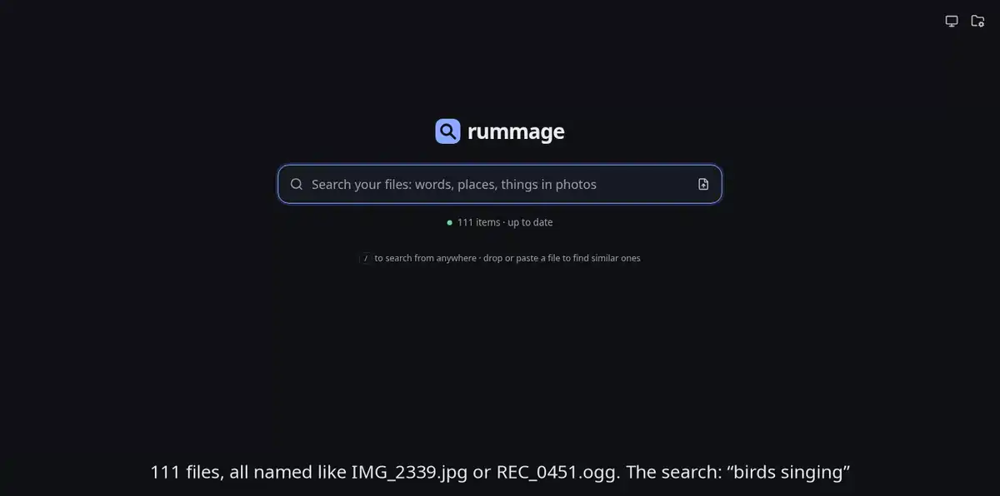
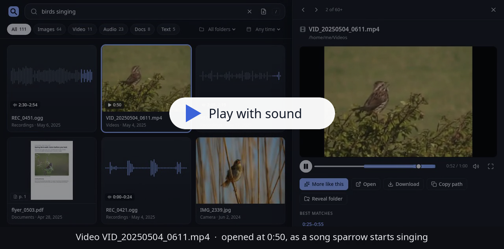
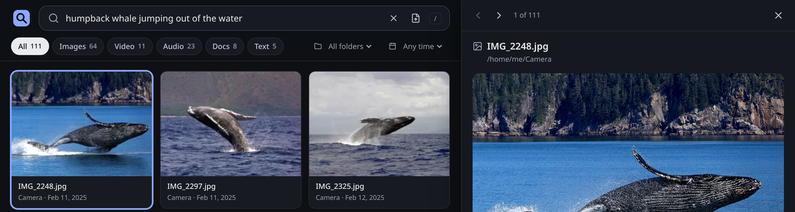
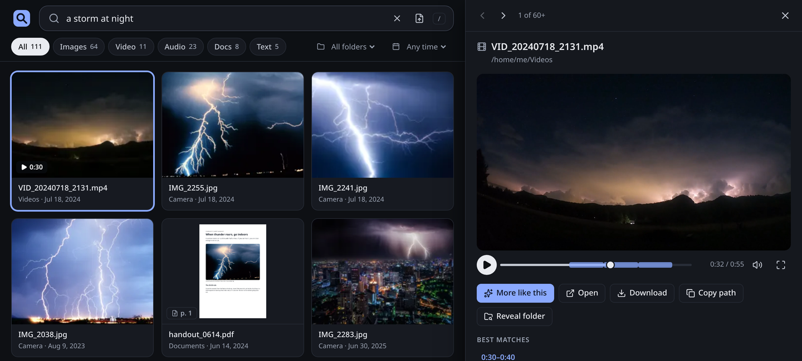
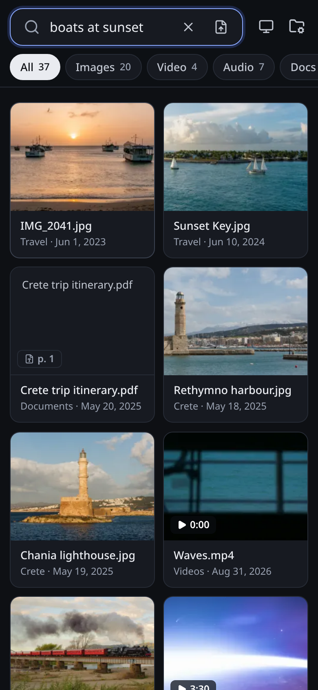
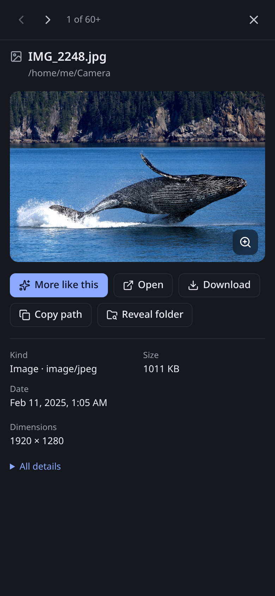

<p align="center">
  
</p>

<h1 align="center">rummage</h1>

<p align="center">
  <b>Search your photos, videos, recordings and documents by what is in them.</b><br>
  rummage indexes folders on your computer and finds files from a description or from an example file.<br>
  It has a web page, a command line and an HTTP API, and runs on a GPU or a CPU.<br>
  Your files and queries stay on your machine; the only download is the search model (about 865 MB).
</p>

<p align="center">
  <a href="https://github.com/av/rummage/releases"></a>
  <a href="https://github.com/av/rummage/actions/workflows/ci.yml"></a>
  <a href="LICENSE"></a>
</p>

<p align="center">
  <a href="#examples">Examples</a> ·
  <a href="#features">Features</a> ·
  <a href="#how-it-works">How it works</a> ·
  <a href="#install">Install</a> ·
  <a href="#status">Status</a> ·
  <a href="#docs">Docs</a>
</p>

<p align="center">
  
</p>

<p align="center"><sub>No file or folder name says “fireworks”, and the query is in Japanese. rummage matched what is <i>in</i> the pictures and the video.</sub></p>

## Examples

These searches ran over a demo library of 111 photos, recordings, videos, PDFs and notes with
camera-style names (`IMG_2248.jpg`, `REC_0451.ogg`), so no query can match a file name.

| Query | Top results |
|---|---|
| **birds singing** | a dawn chorus at 2:30 in a recording; a video at 0:50, where a song sparrow starts singing; a nightingale at 2:05 |
| **humpback whale jumping out of the water** | three photos of breaching humpbacks |
| **a storm at night** | a clip at 0:30, where a sunny beach gives way to a night storm; two photos of lightning |
| **花火** | a fireworks video and fireworks photos |
| **Nordlichter** | aurora photos from Alaska and Lofoten |

“birds singing” as a recording, with sound:

<a href="https://cdn.jsdelivr.net/gh/av/rummage@bd1d2de928c07e755dcd4f13711dbf114c57b14b/docs/screenshots/birds-singing.mp4"></a>

<sub>23 s, MP4 with sound: [play](https://cdn.jsdelivr.net/gh/av/rummage@bd1d2de928c07e755dcd4f13711dbf114c57b14b/docs/screenshots/birds-singing.mp4) · [download](docs/screenshots/birds-singing.mp4)</sub>





Results of every kind share one list: the whale search also lists a PDF page that contains a whale
photo (`booking_HNL_2291.pdf`, in the phone screenshots below). All queries and files are listed in
[Screenshots and demo library](docs/screenshots/README.md).

## Features

- **One index for photos, video, audio, PDFs and text.** What is extracted from each kind is
  listed under [How it works](#how-it-works) and in the [supported files](docs/how-it-works.md#supported-files).
- **Results open at the match.** A video plays from the matching moment, audio from the matching
  seconds, a PDF shows the page, a text hit shows the passage. Phone videos that browsers can’t
  play (HEVC) are converted to a playable copy.
- **Search by description or by example.** Type a query, drop or paste an image, a sound or a note
  on the page, or press “More like this” on a result. Filter by kind, folder and date.
- **Exact words and names match too.** A keyword search over file names, text and photo metadata
  (date, camera, GPS position) runs alongside the search by meaning.
- **Queries in other languages.** The examples above search in Japanese and German.
- **Follows changes.** New, changed, moved and deleted files are picked up as they happen, and
  searches work while a folder is still being indexed.
- **GPU or CPU.** Vulkan (AMD, NVIDIA, Intel), ROCm (AMD) and CUDA (NVIDIA) builds; every build
  falls back to the CPU when it finds no GPU.
- **Web page, CLI and API.** The page has light and dark themes and a phone layout; everything it
  does goes through the [HTTP API](docs/api.md); the [CLI](docs/usage.md#command-line) searches,
  manages folders and shows the index status.

<table align="center">
  <tr>
    <td></td>
    <td></td>
  </tr>
</table>

## How it works

1. **Scan.** rummage reads the folders you add and watches them for changes. It never writes to
   them; the index, thumbnails and model files live in a data folder of their own.
2. **Extract.** Images are decoded upright; video is sampled at 1 frame per second in 10-second
   windows, with its sound track; audio is cut into 30-second windows; PDFs give each page’s text
   and picture; text is split into passages.
3. **Embed.** Google DeepMind’s multilingual [EmbeddingGemma 2](https://huggingface.co/google/embeddinggemma-2)
   turns each piece, and each query, into a vector (a list of numbers), and similar things get
   nearby vectors: a sentence lands near the photo, sound or page it describes. The model runs on [llama.cpp](https://github.com/ggml-org/llama.cpp),
   which is built into the binary.
4. **Search.** The query’s vector is compared with every stored vector, and the ranking is fused
   with a keyword (SQLite FTS5) ranking. Results are grouped by file, each with its best-matching
   moment, page or passage.

The index is a SQLite file. The only connection to the internet is the one-time model download from
Hugging Face. More in [How it works](docs/how-it-works.md).

## Install

### Release build (Linux x86_64)

Ubuntu 22.04, Debian 12 or newer (glibc 2.35+), on a CPU with AVX2. This is the Vulkan build,
which uses any recent AMD, NVIDIA or Intel GPU, or the CPU.

```sh
curl -LO https://github.com/av/rummage/releases/download/v0.1.2/rummage-0.1.2-linux-x86_64-vulkan.tar.gz
tar xzf rummage-0.1.2-linux-x86_64-vulkan.tar.gz
cd rummage-0.1.2-linux-x86_64-vulkan
./rummage folders add ~/Pictures
./rummage serve
```

Open <http://127.0.0.1:8099/> and type a query. The first run downloads the model; results appear
as files are indexed. Video and HEIC photos need [ffmpeg](https://ffmpeg.org), and PDF page pictures
need `poppler-utils`.

### With Harbor

rummage is a service in [Harbor](https://github.com/av/harbor), which picks the CPU, CUDA or Vulkan
image for your hardware and mounts your folder read-only:

```sh
harbor config set rummage.folders ~/Pictures
harbor up rummage --open
```

On the first run the page opens its folders drawer: add `/folders` there. Details:
[rummage in Harbor](https://github.com/av/harbor/wiki/2.3.103-Satellite-Rummage).

ROCm, CUDA and CPU builds, Docker images and building from source: [Install](docs/install.md).
The command line and the page’s features: [Using rummage](docs/usage.md).

## Status

Version 0.1 (pre-release) for Linux x86_64. Checked on a real library of about 4,500 photos, videos,
recordings, notes and PDFs ([review](docs/REVIEW-2026-10.md)).

- Results are ranked by likeness, so a query with no true match still returns the closest files.
- rummage matches what files show and say. It has no face or person recognition.
- Speed: a search takes about 10 ms over 4,500 files. On a Radeon 8060S a 770-file sample of photos,
  audio, video, PDFs and notes indexes in 251 s with Vulkan and in 1,648 s on the CPU
  ([benchmarks](docs/BENCH-fedora.md)).

Bug reports and ideas: [Issues](https://github.com/av/rummage/issues).

## Docs

- [Install](docs/install.md): release builds, Docker, Harbor, from source
- [Using rummage](docs/usage.md): the web page, the command line, running behind a proxy
- [Configuration](docs/configuration.md) · [HTTP API](docs/api.md)
- [How it works](docs/how-it-works.md): supported files, indexing, search
- [Development](docs/development.md)
- [Screenshots and demo library](docs/screenshots/README.md): public-domain and CC0 media from
  Wikimedia Commons, plus a few documents written for the demo

## Licence

[Apache License 2.0](LICENSE); see [NOTICE](NOTICE). rummage builds in llama.cpp and ggml (MIT);
[docs/LICENSES-THIRD-PARTY.md](docs/LICENSES-THIRD-PARTY.md) lists every component and its licence.
