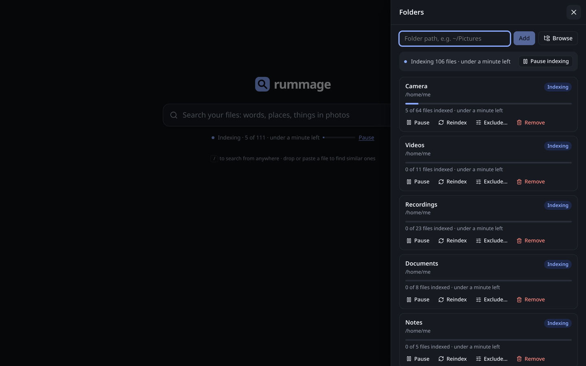

<p align="center">
  
</p>

<h1 align="center">rummage</h1>

<p align="center">
  <b>Search your photos, videos, recordings and documents by what is in them.</b><br>
  Local. One binary. Runs on your GPU.
</p>

<p align="center">
  <a href="https://github.com/av/rummage/releases"></a>
  <a href="https://github.com/av/rummage/actions/workflows/ci.yml"></a>
  <a href="LICENSE"></a>
</p>

<p align="center">
  
</p>

<p align="center"><sub>One query, <b>“birds singing”</b>. Every file is named like <code>REC_0451.ogg</code> or <code>IMG_2339.jpg</code>.<br>
rummage <i>listened</i> to the recordings, <i>watched</i> the video and <i>read</i> the PDF.</sub></p>

## What grep and Spotlight can’t find

A camera roll is `IMG_2248.jpg` all the way down. rummage looks at, listens to and reads the files
themselves, so you search for what you remember, and land on the exact page or second.

<table>
<tr>
<td width="50%"><br>
<b>“humpback whale jumping out of the water”</b><br>
<sub>Three breaching humpbacks, then the tails. No file name says “whale”.</sub></td>
<td width="50%"><br>
<b>“a storm at night”</b><br>
<sub>Opens a clip at 0:30: it starts on a sunny beach, the lightning comes later.</sub></td>
</tr>
<tr>
<td><br>
<b>“when do the whales come to Hawaii”</b><br>
<sub>Page 2 of a boat booking: “From December to April…”. A question, answered by a PDF.</sub></td>
<td><br>
<b>“how do I bake a loaf of bread”</b><br>
<sub>The method in your notes, and the loaves you photographed afterwards.</sub></td>
</tr>
<tr>
<td><br>
<b>“花火”</b><br>
<sub>Japanese for fireworks. Nothing in the library is in Japanese.</sub></td>
<td><br>
<b>Point it at your folders</b><br>
<sub>It indexes in the background and keeps watching. Search works from the first file.</sub></td>
</tr>
</table>

## Try it

Linux x86_64 with any recent GPU ([other builds](docs/install.md)):

```sh
curl -LO https://github.com/av/rummage/releases/download/v0.1.1/rummage-0.1.1-linux-x86_64-vulkan.tar.gz
tar xzf rummage-0.1.1-linux-x86_64-vulkan.tar.gz
cd rummage-0.1.1-linux-x86_64-vulkan
./rummage folders add ~/Pictures
./rummage serve
```

Open <http://127.0.0.1:8099/> and describe what you are looking for. The first run downloads the
model (about 860 MB) from Hugging Face; results fill in while it indexes. The CLI works too:

```sh
./rummage search "birds singing"
./rummage doctor        # GPU, model files, ffmpeg, poppler, config
```

## Why it’s different

- **Sees, hears, reads.** Photos, video frames and soundtracks, audio, PDF text and page images,
  notes and code: one index, one search box.
- **Lands on the moment.** Videos and recordings open at the matching seconds, PDFs at the page,
  notes at the passage.
- **Any language.** Ask in Japanese, German or Spanish: Google DeepMind’s
  [EmbeddingGemma 2](https://huggingface.co/google/embeddinggemma-2) is multilingual.
- **Search by example.** Drop a photo, a sound or a note on the page to find what is like it.
- **Private.** Everything runs on your machine. No account, no cloud, no uploads.
- **One binary, any GPU.** Web UI, CLI and HTTP API in one executable, on Vulkan, ROCm, CUDA or CPU.
- **Keeps up.** New, changed, moved and deleted files are picked up as they happen.

## Docs

[Install](docs/install.md) (release builds, Docker, from source) ·
[Using rummage](docs/usage.md) (web page, CLI, reverse proxy) ·
[Configuration](docs/configuration.md) ·
[HTTP API](docs/api.md) ·
[How it works](docs/how-it-works.md) (supported files, indexing, search) ·
[Development](docs/development.md)

The demo library behind these screenshots is public-domain and CC0 media from Wikimedia Commons,
plus a few documents written for it; [docs/screenshots](docs/screenshots/README.md) lists every
file and the queries.

## Licence

[Apache License 2.0](LICENSE); see [NOTICE](NOTICE). rummage builds in llama.cpp and ggml (MIT);
[docs/LICENSES-THIRD-PARTY.md](docs/LICENSES-THIRD-PARTY.md) lists every component and its licence.
