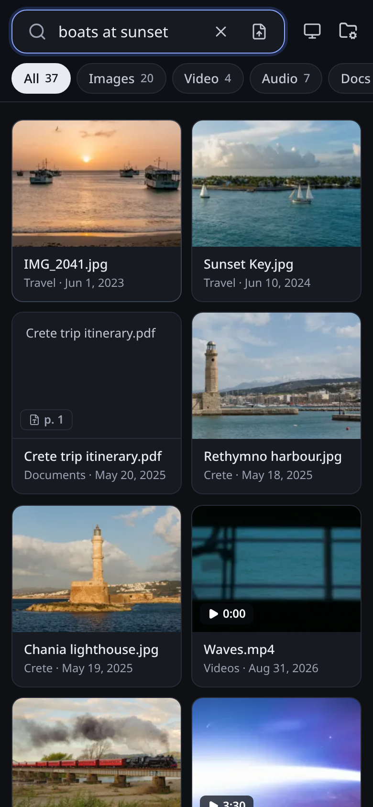
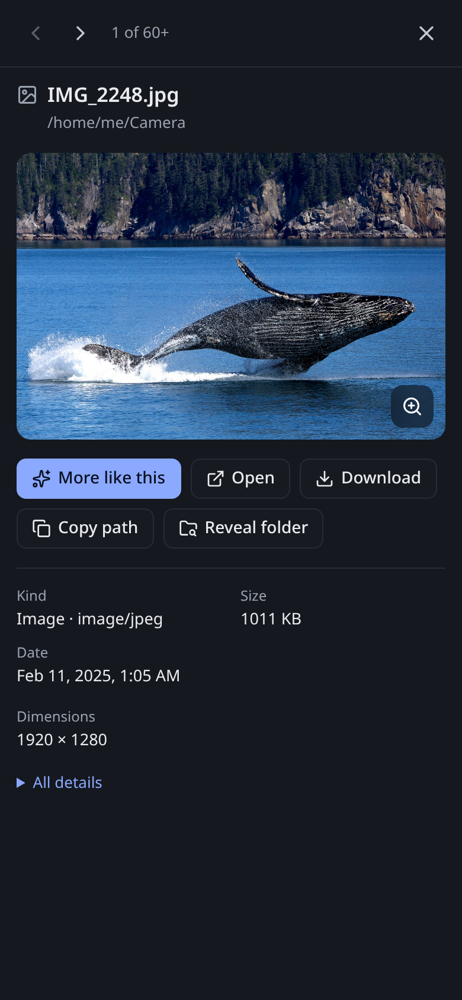

# Screenshots

Taken from the real `rummage` binary (Vulkan build, Radeon 8060S) with Chromium at 1440×900
(phones at 390×844, 2×), dark theme, after indexing the sample files listed below. Every
search shown is typed as is; none of the query words appear in the matching file names.

| File | What it shows |
|---|---|
| `hero.png` | "evening by the sea": photos, a video, a PDF page and recordings in one list |
| `photo.png` | "boats at sunset": the photo `IMG_2041.jpg`, previewed |
| `video.png` | "stars seen from orbit": the ISS video, playing from 0:30 |
| `audio.png` | "people clapping": the applause recording, the matching window marked |
| `pdf.png` | "how do I remove limescale": the espresso machine manual at its descaling page |
| `text.png` | "bread recipe": a markdown note at the matching passage |
| `landing.png` | the start page with recent searches |
| `folders.png` | the folders drawer while indexing |
| `first-run.png` | the first run: the folders drawer opens by itself, browsing the server |
| `phone-results.png`, `phone-preview.png` | the same search on a phone |

 

## Sample files

The PDFs (`Documents/`) and notes (`Notes/`) were written for these screenshots. The photos,
sounds and videos are public domain or CC0, from Wikimedia Commons; some were renamed, the
`.ogv` videos were converted to H.264 MP4, and the NEOWISE video was kept without its
soundtrack (which is not NASA's).

| Sample path | Source | Author | Licence |
|---|---|---|---|
| `Photos/Crete/Chania lighthouse.jpg` | [Lighthouse Chania evening sun.jpg](https://commons.wikimedia.org/wiki/File:Lighthouse_Chania_evening_sun.jpg) | Jebulon | CC0 |
| `Photos/Crete/Rethymno harbour.jpg` | [Harbour snowy mountains Rethymno Crete Greece.jpg](https://commons.wikimedia.org/wiki/File:Harbour_snowy_mountains_Rethymno_Crete_Greece.jpg) | Jebulon | CC0 |
| `Photos/Travel/Acropolis museum owl.jpg` | [Owl of Athena, Acropolis museum, Athens, Greece-2.jpg](https://commons.wikimedia.org/wiki/File:Owl_of_Athena,_Acropolis_museum,_Athens,_Greece-2.jpg) | Jebulon | CC0 |
| `Photos/Travel/Prague firefighter bike.jpg` | [Red Firefighter Bicycle in Prague C.jpg](https://commons.wikimedia.org/wiki/File:Red_Firefighter_Bicycle_in_Prague_C.jpg) | Mojmir Churavy | CC0 |
| `Photos/Travel/Normandy beach.jpg` | [Omaha Beach from Dog Red sector.jpg](https://commons.wikimedia.org/wiki/File:Omaha_Beach_from_Dog_Red_sector.jpg) | Jebulon | CC0 |
| `Photos/Travel/IMG_2041.jpg` | [Juan Griego Sunset.jpg](https://commons.wikimedia.org/wiki/File:Juan_Griego_Sunset.jpg) | Wilfredor | CC0 |
| `Photos/Travel/From the balloon.jpg` | [View of Avermaat and Meerskant from a hot air balloon, Zele, 2026.jpg](https://commons.wikimedia.org/wiki/File:View_of_Avermaat_and_Meerskant_from_a_hot_air_balloon,_Zele,_2026.jpg) | DimiTalen | CC0 |
| `Photos/Travel/Otaki river steam train.jpg` | [JA1271 crossing the Otaki River.jpg](https://commons.wikimedia.org/wiki/File:JA1271_crossing_the_Otaki_River.jpg) | Karora | Public domain |
| `Photos/Travel/Sunset Key.jpg` | [Sunset Key and Sailboats, Florida, 2025.jpg](https://commons.wikimedia.org/wiki/File:Sunset_Key_and_Sailboats,_Florida,_2025.jpg) | Julian Lupyan | CC0 |
| `Photos/Travel/Louvre statue.jpg` | [Paris 1er - Musée du Louvre - L'Aurore (Philippe Magnier) 01.jpg](https://commons.wikimedia.org/wiki/File:Paris_1er_-_Mus%C3%A9e_du_Louvre_-_L%27Aurore_%28Philippe_Magnier%29_01.jpg) | Romainbehar | CC0 |
| `Photos/Travel/Montmorency falls.jpg` | [Parc de la Chute-Montmorency 001.jpg](https://commons.wikimedia.org/wiki/File:Parc_de_la_Chute-Montmorency_001.jpg) | Wilfredor | CC0 |
| `Photos/Travel/Quebec at night.jpg` | [Price Building illuminated at night in Quebec City.jpg](https://commons.wikimedia.org/wiki/File:Price_Building_illuminated_at_night_in_Quebec_City.jpg) | Wilfredor | CC0 |
| `Photos/Travel/Brooklyn bridge fog.jpg` | [Brooklyn Bridge Sunrise Fog (Unsplash).jpg](https://commons.wikimedia.org/wiki/File:Brooklyn_Bridge_Sunrise_Fog_%28Unsplash%29.jpg) | Emanuel Hahn | CC0 |
| `Photos/Travel/Tarcoles river horse.jpg` | [Horse in Tárcoles River.jpg](https://commons.wikimedia.org/wiki/File:Horse_in_T%C3%A1rcoles_River.jpg) | Bernard Gagnon | CC0 |
| `Photos/Travel/Margarita upholsterer.jpg` | [Upholstering the seats of your own car, Margarita Island, Venezuela.jpg](https://commons.wikimedia.org/wiki/File:Upholstering_the_seats_of_your_own_car,_Margarita_Island,_Venezuela.jpg) | Wilfredor | CC0 |
| `Photos/Home/Tabby on the porch.jpg` | [Young tabby cat keeping watch.jpg](https://commons.wikimedia.org/wiki/File:Young_tabby_cat_keeping_watch.jpg) | W.carter | CC0 |
| `Photos/Home/Tulips.jpg` | [Bunch tulip Paris 2011.jpg](https://commons.wikimedia.org/wiki/File:Bunch_tulip_Paris_2011.jpg) | Jebulon | CC0 |
| `Photos/Home/Espresso.jpg` | [Espresso Coffee 01.jpg](https://commons.wikimedia.org/wiki/File:Espresso_Coffee_01.jpg) | Jubair1985 | CC0 |
| `Photos/Home/Carpaccio.jpg` | [Carpaccio de bœuf, restaurant Danieli (Vienne, Autriche).jpg](https://commons.wikimedia.org/wiki/File:Carpaccio_de_b%C5%93uf,_restaurant_Danieli_%28Vienne,_Autriche%29.jpg) | Benoît Prieur | CC0 |
| `Photos/Home/Mushroom dumplings.jpg` | [Semmelknödel and forest mushrooms, Oestrich.jpg](https://commons.wikimedia.org/wiki/File:Semmelkn%C3%B6del_and_forest_mushrooms,_Oestrich.jpg) | Gerda Arendt | CC0 |
| `Sounds/Thunderstorm coming.wav` | [Theres a thunderstorm coming.wav](https://commons.wikimedia.org/wiki/File:Theres_a_thunderstorm_coming.wav) | Czechcamp | CC0 |
| `Sounds/Rain and thunder.ogg` | [Rain and thunder.ogg](https://commons.wikimedia.org/wiki/File:Rain_and_thunder.ogg) | Caesar | Public domain |
| `Sounds/Cathedral bells.ogg` | [St. Nicholas Cossack Cathedral church bells chiming - Zabuhailo.ogg](https://commons.wikimedia.org/wiki/File:St._Nicholas_Cossack_Cathedral_church_bells_chiming_-_Zabuhailo.ogg) | Zabuhailo | CC0 |
| `Sounds/Mozart K330 III.mp3` | [Mozart, Piano Sonata No. 10, K. 330, 3rd movement (Musopen)](https://commons.wikimedia.org/wiki/File:Mozart,_Wolfgang_Amadeus_%E2%80%94_Piano_Sonata_No._10_in_C_major,_K._330,_3rd_movement_%E2%80%94_Vadim_Chaimovich_%E2%80%94_Musopen_-8825.mp3) | Vadim Chaimovich, Musopen | Public domain |
| `Sounds/Cat asking for dinner.ogg` | [Meow of a pleading cat.oga](https://commons.wikimedia.org/wiki/File:Meow_of_a_pleading_cat.oga) | Heismark | Public domain |
| `Sounds/Applause.ogg` | [Sound Effects - Applause after a concert.ogg](https://commons.wikimedia.org/wiki/File:Sound_Effects_-_Applause_after_a_concert.ogg) | Amada44 | CC0 |
| `Sounds/Steam whistle.ogg` | [Parovoz sound.ogg](https://commons.wikimedia.org/wiki/File:Parovoz_sound.ogg) | Alex Alex Lep | Public domain |
| `Videos/Waves.mp4` | [Ocean surface waves 09.ogv](https://commons.wikimedia.org/wiki/File:Ocean_surface_waves_09.ogv) | Mostafameraji | CC0 |
| `Videos/Cumulus time-lapse.mp4` | [Growing cumulus clouds in time lapse.ogv](https://commons.wikimedia.org/wiki/File:Growing_cumulus_clouds_in_time_lapse.ogv) | Wolf170278 | CC0 |
| `Videos/Steam locomotive.webm` | [Mala Morava Steam locomotive 2024-07-27.webm](https://commons.wikimedia.org/wiki/File:Mala_Morava_Steam_locomotive_2024-07-27.webm) | Nostrifikator | CC0 |
| `Videos/Comet NEOWISE from the ISS.webm` | [NEOWISE from the International space station.webm](https://commons.wikimedia.org/wiki/File:NEOWISE_from_the_International_space_station.webm) | NASA | Public domain |

`bun run screenshots` in `crates/rummage/ui` renders the mock UI into this folder for checking
UI changes; those files are not the ones committed here.
